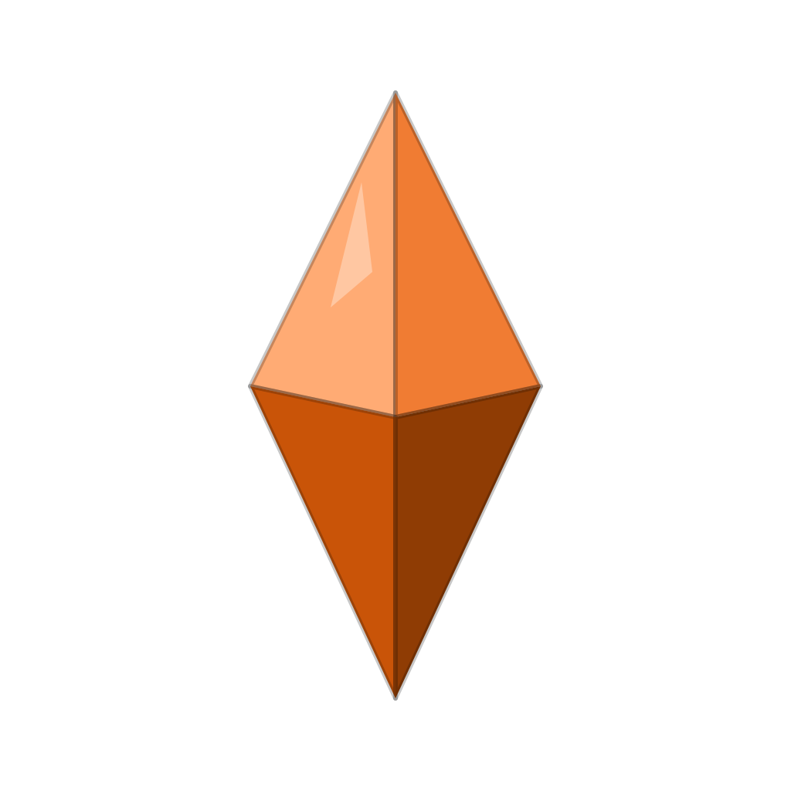

  

<h1 align="center">Oxidean</h1>

  Building the next generation of development tooling.

  <a href="https://oxidean.dev">oxidean.dev</a> ·
  <a href="https://app.oxidean.dev">Oxidean Cloud</a> ·
  <a href="mailto:contact@oxidean.dev">contact@oxidean.dev</a>

## What we do

Oxidean builds development tooling you can run yourself.

- **[Oxidean](https://github.com/oxidean/oxidean)** — a self-hostable forge for
  social coding: git hosting, pull requests, issues, CI actions, releases, and
  package registries — shipped as one codebase for
  [Oxidean Cloud](https://app.oxidean.dev) and for Docker Compose or Kubernetes
  on your own machines.
- **[oxl](https://github.com/oxidean/oxl)** — a lean, compiled language for CLI
  tools and services: dynamic ownership/borrow checking instead of a tracing GC
  or a static borrow checker, structured concurrency, ahead-of-time native
  builds from one toolchain binary.

## Around the org

- **Site:** [oxidean.dev](https://oxidean.dev)
- **Product:** [app.oxidean.dev](https://app.oxidean.dev) — hosted Oxidean Cloud
- **Contributing:** each repo's own guide wins; the org-wide defaults live in
  [this repo](https://github.com/oxidean/.github)
- **Security:** [SECURITY.md](https://github.com/oxidean/.github/blob/main/SECURITY.md) — report
  privately, never in public issues
